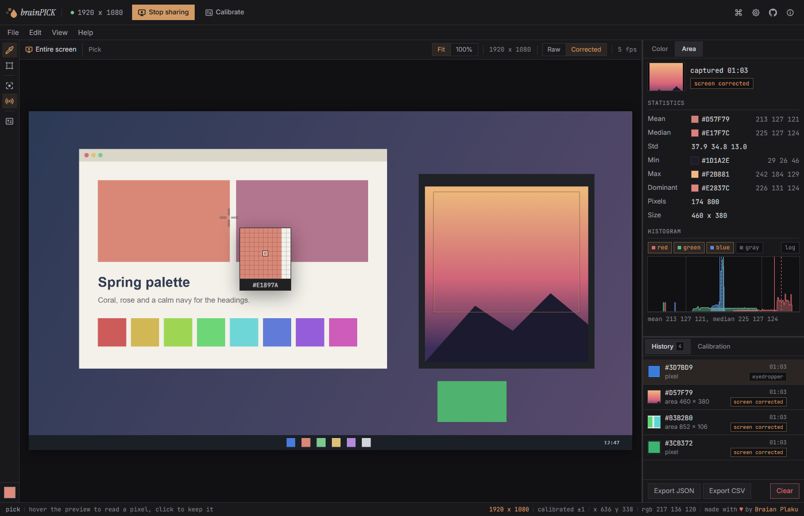

<p align="center">
  
</p>

<h1 align="center">brainPICK</h1>

<p align="center">
  A screen color picker that runs in your browser.<br/>
  Pick a pixel, then read the whole area.
</p>

<p align="center">
  
</p>

<p align="center">
  <a href="https://color.swimmingbrain.dev"><strong>Try it now &rarr; color.swimmingbrain.dev</strong></a>
</p>

brainPICK is an open source app for picking colors off the screen, like Digital Color Meter and the PowerToys Color Picker, but in a browser tab. It is made for designers and developers who need the exact value of a pixel or of a whole area. There is no account and no server, everything stays in your browser.

## Features

- Pick any pixel on the screen with the eyedropper the browser has built in, no share needed
- Share a screen, a window or a tab and hover it, a loupe shows the pixels under the pointer
- Draw an area and read its mean, median, spread, darkest and brightest value and its most common color
- A histogram for red, green, blue and gray, on a log scale if you like, with the mean and the median marked
- A calibration that measures how the share shifts colors and corrects every value after it
- A history of picks and areas in this browser, exported as JSON or CSV
- Keys for every tool and a command palette
- Works offline once it has been opened

## Shortcuts

| Key | What it does |
|-----|--------------|
| `S` | Share the screen or stop sharing |
| `F` `A` | Pick, area |
| `C` `L` `K` | Capture the area, live preview, calibrate |
| `Ctrl+C` | Copy the hex of the current color |
| `Delete` | Remove the selected history entry |
| `Ctrl+E` | Export the history as JSON |
| `Esc` | Cancel a drag or close a dialog |
| `Ctrl+K` | Command palette |
| `?` | All shortcuts |

## How the calibration works

A screen share does not hand over the exact colors of the screen. The browser adjusts colors to the monitor and the share turns the frames into video and back, so a color can come out several steps off. Calibrate (`K`) shows a card of 56 known colors on the stage for a moment, reads it back through the share and fits a correction to the difference, with 16 of the colors kept out of the fit to check it. The correction then applies to hover values, picks from the preview and area statistics, never to the eyedropper, which reads the screen itself.

On the monitor it was measured on, the error of those 16 colors went from mean 4 and max 33 to mean 0.6 and max 2. Fully saturated primaries the monitor cannot show stay off, no correction brings them back.

## Privacy

Everything stays in this browser. The shared frames are read in the tab and never leave it, nothing is recorded or uploaded. The history, the calibration and the settings are kept in localStorage. After the page has loaded the app sends nothing to anyone, the fonts come with it. The open tab only asks its own site now and then whether a new version is out. [docs/SECURITY.md](docs/SECURITY.md) has the details.

## Running locally

```bash
pnpm install
pnpm dev
```

Open `http://localhost:5173`. `pnpm test` runs the tests, `pnpm check` the type checks and `pnpm build` writes the static site to `build/`. See [docs/CONTRIBUTING.md](docs/CONTRIBUTING.md) if you want to help.

## Tech stack

| Part | Library |
|------|---------|
| Framework | Svelte 5 + SvelteKit (static adapter) |
| Shortcuts | tinykeys |
| Fonts | Inter, JetBrains Mono, Instrument Serif from Fontsource (OFL) |
| Language | TypeScript |

## License

MIT, see [LICENSE](LICENSE). The libraries keep their own licenses, [THIRD_PARTY_LICENSES](THIRD_PARTY_LICENSES) lists them.
